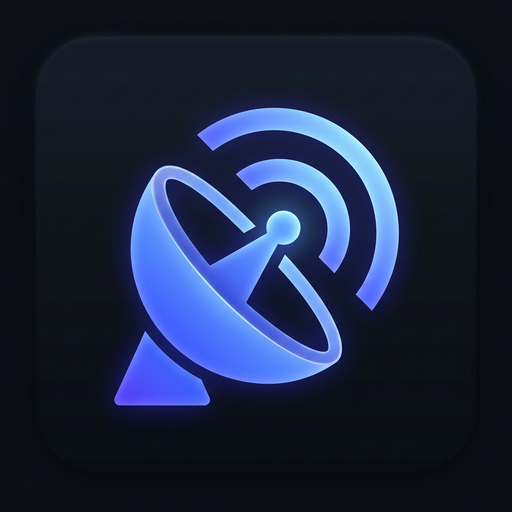

<div align="center">



# MediaGrabber — Jellyfin Edition

**Official Jellyfin Plugin for [MediaGrabber](https://github.com/ai-mayhemyt/mediagrabber)**

Queue YouTube, YouTube Music, Spotify, Instagram, and TikTok media downloads straight into your MediaGrabber libraries without leaving Jellyfin.


</div>

---

## Copy Jellyfin Plugin Repository URL

Copy this URL and add it under **Jellyfin → Dashboard → Plugins → Repositories → `+`**:

```text
https://github.com/ai-mayhemyt/MediaGrabber-Jellyfin-Edition/releases/latest/download/manifest.json
```

---

## What This Plugin Does

**MediaGrabber — Jellyfin Edition** bridges your Jellyfin Dashboard directly to your running MediaGrabber server so you never have to switch apps to grab new media:

- **Single & Bulk Media Queueing**: Paste one URL or a multi-line playlist/batch of links from **YouTube**, **YouTube Music**, **Spotify**, **Instagram**, **TikTok**, and supported `yt-dlp` / `gallery-dl` sources directly inside Jellyfin.
- **Video & Audio Modes**: Choose **Video (MP4/MKV/WebM)** or **Audio Only (MP3/FLAC/M4A/Opus)** per submission or set a global default.
- **Inline API Key & Server Settings**: Configure and test your MediaGrabber Server URL and required API key right inside **MediaGrabber Downloader** or **Dashboard → Plugins → MediaGrabber**.
- **Live Queue Monitor & Job Controls**: Watch active downloads progress in real time inside Jellyfin, cancel queued/running jobs, or retry failed items.
- **Strict API Key Security**: Downloads, queue inspection, cancellations, and retries strictly require a valid `download`- or `admin`-scoped MediaGrabber API key generated in MediaGrabber (**Account → API Tokens**).
- **All-Version Jellyfin Support**: Automated CI builds dedicated `.zip` packages for **Jellyfin 10.8.x**, **10.9.x**, **10.10.x**, and **10.11+**.

---

## Supported Jellyfin Versions

| Jellyfin Series | Target Framework | Target ABI |
| --- | --- | --- |
| Jellyfin 10.11+ | `.NET 9.0` | `10.11.0.0` |
| Jellyfin 10.10.x | `.NET 8.0` | `10.10.0.0` |
| Jellyfin 10.9.x | `.NET 8.0` | `10.9.0.0` |
| Jellyfin 10.8.x | `.NET 6.0` | `10.8.0.0` |

---

## Installation & Setup

### Option 1: Install via Jellyfin Plugin Repository (Recommended)
1. In Jellyfin, open **Dashboard → Plugins → Repositories**.
2. Click **`+` (Add)** and paste:
   - **Repository Name:** `MediaGrabber - Jellyfin Edition`
   - **Repository URL:**
     ```text
     https://github.com/ai-mayhemyt/MediaGrabber-Jellyfin-Edition/releases/latest/download/manifest.json
     ```
3. Open **Catalog → General → MediaGrabber**, select the build matching your Jellyfin version, and click **Install**.
4. **Restart Jellyfin** to load the plugin and its icon/thumbnail.

### Option 2: Configure Your MediaGrabber API Key (Required)
1. In your **MediaGrabber** web console, open **Account → API Tokens**, select **`download`** (or **`admin`**) scope, give it a name like `Jellyfin`, and click **Create** to copy your `mg_...` API key.
2. In **Jellyfin**, open **MediaGrabber Downloader** in the sidebar (or **Dashboard → Plugins → MediaGrabber**).
3. Enter:
   - **MediaGrabber Server URL** (e.g. `http://127.0.0.1:3000` or your LAN/Tailscale URL)
   - **MediaGrabber API Key** (`mg_...`)
4. Click **Test Connection & API Key**, then **Save API Key & Connect**.

---

## Manual Build from Source

Requires the matching .NET SDK (`6.0`, `8.0`, or `9.0`):

```bash
# Swap JellyfinSeries=10.8 | 10.9 | 10.10 | 10.11
dotnet publish MediaGrabber.Jellyfin/MediaGrabber.Jellyfin.csproj \
  -c Release \
  -p:JellyfinSeries=10.10 \
  -o ./dist/MediaGrabber
```

Copy `./dist/MediaGrabber/MediaGrabber.Jellyfin.dll` and `./logo.png` (renamed to `thumb.png`) into your Jellyfin plugins folder and restart Jellyfin.
